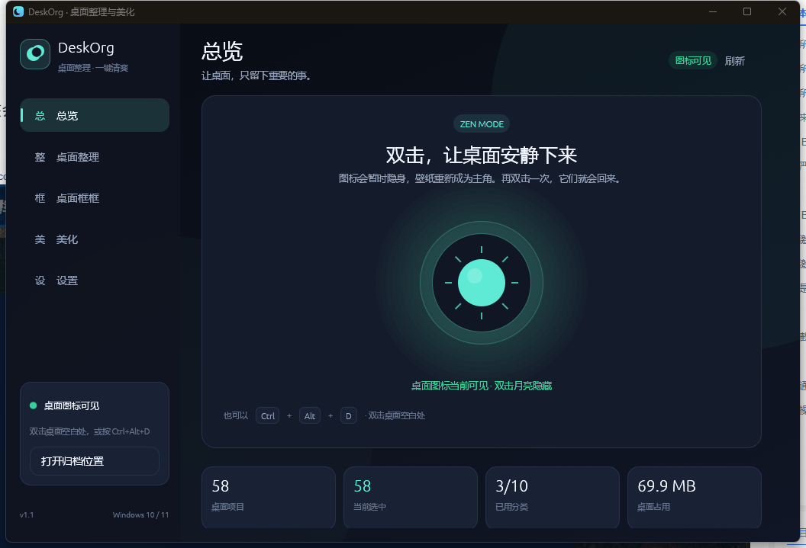
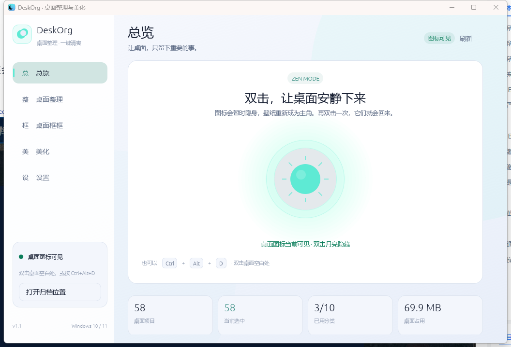
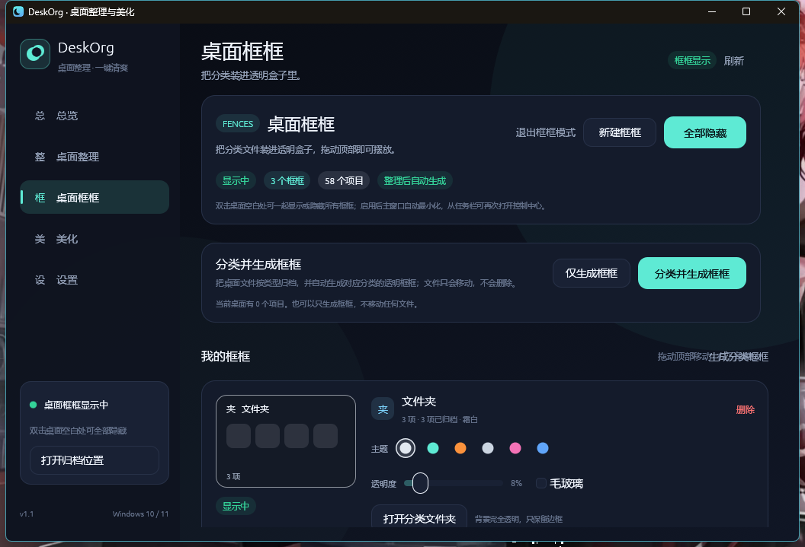

# DeskOrg · 桌面整理与美化

一个用 Rust 编写的 Windows 桌面整理与美化工具：把桌面上散落的文件按类型收进分类文件夹，再把分类结果装进可以自由摆放的透明桌面框框。框框模式下原生桌面图标始终保持隐藏，双击桌面空白处或按快捷键，会让**所有框框一起显示或一起隐藏**，不会再切换成回收站等原生图标。

**发行者：陕西十方数联科技有限公司**







## 功能

### 1. 桌面智能整理

- 扫描当前用户桌面，并可选择同时扫描公共桌面。
- 按 10 个类别自动归位：图片、文档、视频、音频、压缩包、安装包、代码、快捷方式、文件夹、其他。
- **快捷方式不归档**：`.lnk` / `.url` 等快捷方式始终留在桌面，不会被移动进 `DeskOrg\快捷方式`；框框仍会正常显示它们。
- 移动前先预览；默认全选，也可逐项勾选，或按分类/关键字筛选。
- 不删除任何文件。移动到 `桌面\DeskOrg\<分类>\`，同名文件自动追加 `(2)`、`(3)`，不覆盖。
- 跳过 `desktop.ini`、隐藏/系统文件和符号链接。
- 每次整理都会记录撤销日志，一键“撤销上次整理”把文件放回原位置；如果桌面已有同名文件，同样自动改名。
- 公共桌面中的项目可能需要管理员权限，失败项会保留选择并给出提示。

### 2. 透明桌面框框

点“桌面整理”并确认后，默认会按分类自动生成透明框框，把原生桌面图标收进框框视图；也可以只生成框框、不移动任何文件。

- 每个框框对应一个分类，显示该分类的桌面项目和 `DeskOrg/<分类>/` 中已归档的文件。
- 直接使用 **Windows 原生 Shell 图标**（快捷方式、文件夹、Word/Excel/PDF 等图标与桌面一致），并显示**隐藏扩展名的单行文件名**（`.lnk`、`.txt`、`.docx` 等后缀不显示，文件夹名保持原样）；悬停可看完整路径。
- **每个图标不再套单独的小卡片/边框**，图标和文字直接浮在框框里。
- 框框默认近乎透明，只保留主题边框、原生图标和文字。
- **每个框框可以单独设置主题**：霜白、薄荷、落日、墨黑、樱花、深海。
- **每个框框可以单独设置透明度**（0%–80%）。
- **毛玻璃**：开启后会采样当前壁纸并做模糊，形成静态磨砂玻璃背景；没有壁纸时使用主题渐变。
- 框框固定在**普通应用窗口下方**（`WindowLevel::AlwaysOnBottom`），打开 DeskOrg 或切换应用时不会突然盖到其他程序前面；只有在桌面本身可见的区域才会看到框框。
- **按 Win+D 显示桌面时框框保持可见**：独立守护线程检测到桌面层在前台且没有其他可见应用时，会把框框临时抬到桌面之上；切回普通应用后自动沉回底层。
- 框框可以拖动顶部移动、拖右下角缩放；位置和尺寸会持久化。拖动使用 Windows 原生窗口移动循环，避免透明窗口逐帧移动时闪烁。
- “桌面框框”页面可以新建 / 删除框框；删除框框不会删除任何文件。
- 双击框框内的文件即可打开；右上角按钮打开分类文件夹，× 删除框框。
- 启用框框或下次启动时主窗口会收进右下角通知区，不占任务栏；点托盘里的 DeskOrg 图标重新打开控制中心。
- 框框模式下原生桌面图标始终隐藏；双击只切换“全部框框显示 / 全部框框隐藏”，不会出现回收站、文件夹等原生图标。
- 想恢复原生桌面图标，在“桌面框框”页点“退出框框模式”。

### 3. 双击清爽模式

三种方式都可以切换桌面图标：

| 方式 | 操作 |
| --- | --- |
| 应用内 | 双击首页中央的月亮/太阳圆盘 |
| 桌面 | 双击桌面**空白处**（双击文件/图标不会触发） |
| 快捷键 | `Ctrl + Alt + D`（窗口隐藏/托盘运行时也有效） |

隐藏的是 Windows 的“显示桌面图标”状态，不会关闭程序、不会删除文件、不会改动壁纸。重复一次手势即可恢复。

### 4. 桌面美化

- 深色 / 浅色两套完整主题。
- 薄荷、星蓝、薰衣草、蜜桃、樱花、青柠 6 种强调色。
- 选择图片并一键设为 Windows 壁纸，内置预览。
- 可选“整理后自动进入清爽模式”。
- 默认“退出时恢复桌面图标”，避免图标留在隐藏状态。

### 5. 开机启动与后台运行

“设置 → 启动与退出”提供两个开关：

- **开机自动启动**：写入当前用户的
  `HKCU\Software\Microsoft\Windows\CurrentVersion\Run`，命令为
  `"当前 DeskOrg.exe 路径" --background`，登录 Windows 后静默启动，不需要管理员权限。
- **关闭主窗口后继续在后台运行**：点窗口右上角 × 时收进右下角通知区，不退出程序，也不保留任务栏大图标；框框、桌面双击手势和 `Ctrl+Alt+D` 继续工作。点托盘图标或右键菜单可以重新打开/退出。
- **以管理员身份重启**：如果移动公共桌面项目或受保护目录时提示没有权限，可在“设置 → 启动与退出”点“以管理员身份重启”，通过 UAC 重新启动 DeskOrg；默认仍以普通权限运行。
- 托盘菜单包含“打开 DeskOrg”“显示 / 隐藏框框”“退出 DeskOrg”；首次运行会自动把图标放到通知区，而不是藏在 `^` 溢出菜单里。
- 关闭该开关后，点 × 会直接退出，并在退出时按“恢复桌面图标”设置还原图标。

### 6. 本地优先

- 无账号、无云同步、无遥测、无 Windows 服务。
- 默认不需要管理员权限。
- 单实例运行：重复启动不会出现两个监听同一手势的窗口，而是唤起已运行实例。
- 配置和撤销记录只保存在本机：

```text
%APPDATA%\DeskOrg\config.json
%APPDATA%\DeskOrg\undo.json
```

如果这两个 JSON 文件损坏，程序会把原文件备份为 `config.json.corrupt` / `undo.json.corrupt`，恢复默认设置并在启动时提示，不会静默覆盖。

## 快速开始

### 直接运行

1. 运行 `dist\DeskOrg.exe`。
2. 点“桌面整理”，检查后点“整理选中”；确认框里保持勾选“整理后生成透明桌面框框”，程序会归档文件、生成框框并把控制窗口收进托盘。
3. 也可以打开“桌面框框”页，点“仅生成框框”只做视觉分类、不移动文件。
4. 双击首页的大圆盘，或双击桌面空白处，即可在“全部框框显示”和“全部框框隐藏”之间切换；原生桌面图标不会出现。

> 这是本地构建的未签名程序。若 Windows SmartScreen 首次提示“Windows 已保护你的电脑”，点“更多信息 → 仍要运行”。如果系统启用了 Smart App Control 或企业应用控制策略，可能需要手动允许该程序。

### 从源码构建

要求：Windows 10/11、Rust stable（MSVC toolchain，1.95+）。

```powershell
cargo build --release
python tools\set_version_info.py target\release\deskorg.exe
python tools\set_icon.py target\release\deskorg.exe
# 产物：target\release\deskorg.exe
```

`tools\set_version_info.py` 会把发行者、产品名、版本号、版权写入 Windows
VERSIONINFO 资源；`tools\set_icon.py` 会把 `assets/icon.png` 以多尺寸
RT_ICON / RT_GROUP_ICON 写入 exe，两者都需要 Python + Pillow。

文件属性 → 详细信息里可以看到：

| 字段 | 内容 |
| --- | --- |
| 公司 | 陕西十方数联科技有限公司 |
| 产品名称 | DeskOrg 桌面整理与美化 |
| 文件说明 | DeskOrg 桌面整理、桌面框框与美化工具 |
| 文件版本 | 1.1.0.0 |
| 版权 | Copyright © 2026 陕西十方数联科技有限公司 |

> 这是文件属性元数据，不是数字签名。当前 exe 没有 Authenticode 签名，因此 Windows SmartScreen / UAC 仍可能显示“未知发布者”。要让系统级“发行者”显示公司名称，需要用受信任的代码签名证书签名，例如：
>
> ```powershell
> signtool sign /fd SHA256 /tr http://timestamp.digicert.com /td SHA256 `
>   /f company-code-signing.pfx /p <密码> dist\DeskOrg.exe
> ```

运行测试：

```powershell
cargo test
```

## 使用说明

### 整理文件

1. 进入“桌面整理”。
2. 用分类标签或搜索框筛选，勾选要移动的项目；“全选/清空”可批量操作。
3. 点“整理选中 (N)”，确认归档位置。
4. 需要反悔时点“撤销上次整理 · N 项”。

只移动桌面第一层项目。归档文件夹本身不会被再次整理。

### 桌面框框

1. 进入“桌面框框”。
2. “分类并生成框框”会归档全部桌面项目并生成框框；“仅生成框框”只创建框框，不移动文件。
3. “新建框框”可为尚未使用的分类添加框框；每个分类一个框框。
4. 在框框卡片上调整主题、透明度、毛玻璃，或删除框框。
5. 拖动框框顶部移动，拖右下角缩放（原生移动，不闪烁）。启用后主窗口会收进托盘，框框留在桌面上。

### 隐藏 / 显示图标

- 框框模式下双击应用内月亮：隐藏全部框框；再双击：显示全部框框。
- 框框模式下双击桌面空白处：在“全部显示”和“全部隐藏”之间切换。
- `Ctrl + Alt + D`：同上，不会切换到原生桌面图标。
- 要恢复回收站等原生图标：桌面框框页 →“退出框框模式”。
- 若程序被强制结束而来不及恢复，可在桌面右键 →“查看”→“显示桌面图标”手动恢复。

### 壁纸

在“美化 → 桌面壁纸”选择图片，点“应用为壁纸”。仅修改当前 Windows 壁纸，不改锁屏和主题。

### 开机启动与退出

在“设置 → 启动与退出”：

- 打开“开机自动启动”会写入当前用户的 Run 键，下次登录自动以 `--background` 静默启动。
- 打开“关闭主窗口后继续在后台运行”后，× 会把主窗口收进右下角通知区，不保留任务栏大图标；框框和手势继续工作。
- 点托盘图标打开控制中心；右键托盘图标可以显示/隐藏框框或退出。
- 要彻底结束进程：右键托盘 →“退出 DeskOrg”，或关闭“后台运行”后点 ×，或设置页的“退出 DeskOrg”。

## 设计说明

- UI：`eframe` / `egui 0.37`，自绘渐变、卡片、开关、月亮按钮和分类色块；启动时自动加载微软雅黑等系统中文字体。
- 桌面图标：通过 `FindWindowW` / `EnumWindows` 定位 Explorer 的 `SHELLDLL_DefView`，向它发送 shell 命令 `WM_COMMAND 0x7402`（即“显示桌面图标”开关）；状态通过 `IsWindowVisible` 校验，失败时回退到直接显示/隐藏 `SysListView32`。
- 桌面双击：采用 20ms 输入轮询（`GetAsyncKeyState` + `GetCursorPos`），不安装全局鼠标钩子；只有当两次按下都落在桌面图标窗口、且没有选中图标时才触发。这样双击普通文件不会误触，也能减少安全软件误报。
- 主题：`DwmSetWindowAttribute` 同步 Windows 标题栏深色/浅色和圆角。
- 开机启动：写入 `HKCU\Software\Microsoft\Windows\CurrentVersion\Run\DeskOrg`，值为加引号的当前 exe 路径加 `--background`；关闭开关时删除该值，不修改 HKLM、不需要管理员权限。
- 托盘：`Shell_NotifyIconW` 管理通知区图标，托盘窗口运行在**独立消息线程**，即使主窗口隐藏、egui 暂停绘制也能响应点击；左键打开主窗口，右键弹出“打开 / 显示隐藏框框 / 退出”菜单。托盘线程用 40ms 定时器检测图标区域内的左键按下，作为个别 Windows 11 版本不派发 `WM_LBUTTONUP` 时的兜底。Windows 11 默认把新图标放进 `^` 溢出区，程序会找到当前 exe 对应的 `NotifyIconSettings` 项并设置 `IsPromoted=1`，让图标直接出现在右下角。
- 后台运行：拦截根窗口的 `close_requested`，发送 `CancelClose + ShowWindow(SW_HIDE)`，不保留任务栏按钮，同时保持 egui 事件循环运行；托盘“打开”通过 `ShowMain` 事件调用 `ShowWindow(SW_SHOW/SW_RESTORE)` 并重绘。设置页的“退出 DeskOrg”通过 `force_quit` 绕过拦截真正退出。
- 文件移动：以 `std::fs` 为主，Windows 下用 `MoveFileExW` 做“不覆盖”改名；目标同名时自动换序号重试，不会覆盖已存在文件。移动在后台线程执行，界面显示进度，可点“停止”在当前文件完成后中断；跨盘时对文件退化为复制后删除；撤销日志在每次成功移动后逐条落盘，进程中断也尽量保留已移动文件的撤销记录；核心路径和冲突处理有单元测试。
- 后台任务：桌面扫描、整理/撤销在后台线程执行；壁纸预览只在进入“美化”页时加载，毛玻璃纹理只在实际开启 blur 的框框存在时才加载，避免启动时无谓解码大图；主循环空闲时约 1 Hz 轮询，热键/托盘事件会主动唤醒 UI，不再固定 250 ms 重绘。
- 桌面框框：每个框框是一个独立、无边框、透明的 eframe 多视口窗口，`WindowLevel::AlwaysOnBottom`，不置顶、不占任务栏；独立守护线程每 100ms 检查前台窗口，普通应用在前台时把框框压到底层，Win+D 显示桌面时临时抬到桌面之上，切回应用后再沉底；框框模式下原生图标保持隐藏，双击只切换框框层的整体显示/隐藏。拖动通过 `WM_NCLBUTTONDOWN + HTCAPTION` 进入 Windows 原生移动循环（比逐帧发送 `OuterPosition` 更顺滑，也避免透明窗口闪烁）；缩放通过 `InnerSize` 完成并写回配置。毛玻璃是“壁纸模糊”实现：启动或更换壁纸时读取当前壁纸，缩略后高斯模糊成纹理，再按框框在屏幕上的位置裁剪采样，因此不需要管理员权限或 Explorer 注入。

### 项目结构

```text
src/
  main.rs      窗口入口、单实例与程序图标
  app.rs       五个页面、框框视口、交互状态、确认框、Toast
  desktop.rs   扫描、分类、移动、撤销、测试
  fences.rs    框框数据、主题、布局、透明/毛玻璃渲染、测试
  shell.rs     Windows 图标开关、开机启动、桌面双击/快捷键轮询、壁纸、DWM
  config.rs    配置、框框配置与撤销日志
  single_instance.rs  命名互斥量单实例
  theme.rs     配色、字体、egui 样式
  widgets.rs   自绘控件与背景
assets/
  icon.png     程序窗口/任务栏图标源图
tools/
  set_version_info.py  Windows 文件属性 / 发行者元数据
  set_icon.py          exe 多尺寸图标资源
```

## 已知限制

- 仅支持 Windows 10/11。
- 双击空白桌面的手势依赖 Explorer 的标准桌面窗口；第三方桌面壳或极特殊的多显示器布局下可能只对主桌面生效，此时仍可使用快捷键和首页按钮。
- 框框当前绑定分类，每个分类一个；不支持把任意文件拖进框框。
- 如果归档位置改到桌面之外，桌面上旧的默认 `DeskOrg` 文件夹会被自动跳过，不会被当成普通文件夹再次整理。
- 快捷方式只显示在桌面框框里，不参与归档；`DeskOrg\快捷方式` 不会再生成或写入。
- 框框是 DeskOrg 自己的透明窗口，显示分类中的原生图标与文件名并双击打开；不是把 Explorer 原生图标重新挂到窗口里。
- 框框的“毛玻璃”是壁纸模糊（静态），不是实时 Acrylic 背景；这样在不同 Windows 版本上表现一致。
- 框框模式下原生桌面图标不会显示；主窗口关闭、退出框框模式或程序退出时，DeskOrg 会恢复**它自己隐藏的**桌面图标；如果图标原本就是你手动隐藏的，退出时保持隐藏。
- 移动公共桌面项目可能需要管理员权限。
- 图标隐藏状态是系统级设置；程序异常退出时请用桌面右键菜单恢复。
- 未签名构建在部分受管电脑上会被 SmartScreen / Smart App Control 拦截。
- 若把程序放进强制低完整性的沙箱运行，Windows 会阻止它向 Explorer 发送图标开关命令；请把 `DeskOrg.exe` 放在普通本地目录并直接运行。

## Code signing policy

Free code signing provided by [SignPath.io](https://signpath.io), certificate by [SignPath Foundation](https://signpath.org).

See [CODE_SIGNING_POLICY.md](CODE_SIGNING_POLICY.md) for team roles, system changes, and the release signing process. Privacy details are in [PRIVACY.md](PRIVACY.md).

Current release binaries are unsigned while the project applies for SignPath Foundation code signing.

## License

MIT
